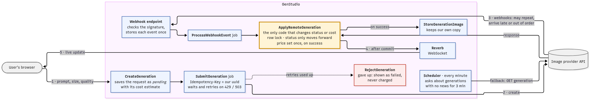

# GenStudio

Generate images with AI and pay exactly what each one costs: the image provider's price plus 25%, worked out to the billionth of a dollar. You see the estimated cost before you start, live progress while it runs, and the exact charge when it's done. Failed images are free.

**Demo:** [pe.rachid.fyi](https://pe.rachid.fyi)

## Run it with Docker

1. Install [Docker Desktop](https://www.docker.com/products/docker-desktop/) and open it.
2. Download this project: **Code** button > **Download ZIP**, then unzip it (or `git clone` it).
3. Open a terminal in the project folder and run:

    ```bash
    make start
    ```

    No `make`? Run `sh scripts/start.sh` instead. On Windows, use Git Bash or WSL.

4. Open **http://localhost:8000** and create an account. No email confirmation is needed.

The first start takes a few minutes. `make stop` stops everything; your data is kept.

**To generate images**, step 3 created a file called `.env`. Fill in your image provider's details there, then run `make start` again:

```dotenv
IMAGE_PROVIDER_BASE_URL=https://.../v1
IMAGE_PROVIDER_API_KEY=...
IMAGE_PROVIDER_WEBHOOK_SECRET=...
IMAGE_PROVIDER_SIGNATURE_HEADER=...
```

## Deploy on Laravel Cloud (not tested)

1. Create an application from this repository and pick the newest PHP version.
2. Attach a Postgres database, an object storage bucket (as the default disk) and WebSockets (Reverb).
3. Turn on the scheduler and add a queue worker.
4. Add the four `IMAGE_PROVIDER_*` settings above to the environment, deploy, and set the provider's webhook URL to `https://<your-domain>/webhooks/provider`.

## How it works



## Where to look first

| What                                                                                               | Where                                                                                                      |
| -------------------------------------------------------------------------------------------------- | ---------------------------------------------------------------------------------------------------------- |
| Money is exact: whole nanodollars, one rounding rule                                               | [`app/Pricing/PriceCalculator.php`](app/Pricing/PriceCalculator.php)                                       |
| The only code that changes a status or a cost (row lock, statuses only move forward, charged once) | [`app/Actions/ApplyRemoteGeneration.php`](app/Actions/ApplyRemoteGeneration.php)                           |
| Every order of duplicate and late webhooks ends in exactly one charge                              | [`tests/Feature/ApplyRemoteGenerationTest.php`](tests/Feature/ApplyRemoteGenerationTest.php)               |
| Webhooks: signature check, stored once, processed on the queue                                     | [`app/Http/Controllers/ProviderWebhookController.php`](app/Http/Controllers/ProviderWebhookController.php) |
| Rate limits and outages: retries with the same idempotency key                                     | [`app/Jobs/SubmitGeneration.php`](app/Jobs/SubmitGeneration.php)                                           |

More detail: [how it works and why](docs/ARCHITECTURE.md) · [development, tests and CI](docs/DEVELOPMENT.md)
