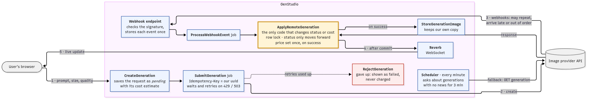

# How it works

Laravel 13 + Vue 3 + Inertia 3, Postgres 18. Users generate images through an image-generation API (the provider) and pay the provider's cost plus 25%.

## Flow

The create response, webhooks and the scheduler's fallback poll all end in `ApplyRemoteGeneration`, so duplicates and late arrivals are handled in one place. The diagram's source is [`diagrams/flow.mmd`](diagrams/flow.mmd) (Mermaid); `make diagrams` re-renders it.

| Folder              | What lives there                                                                                  |
| ------------------- | ------------------------------------------------------------------------------------------------- |
| `app/Pricing`       | Money and pricing rules. Plain PHP, no framework code (enforced by an arch test).                 |
| `app/ImageProvider` | The HTTP client, typed errors, webhook signature check. The only code that talks to the provider. |
| `app/Actions`       | `CreateGeneration`, `ApplyRemoteGeneration`, `RejectGeneration`.                                  |
| `app/Jobs`          | Submission with retries, webhook processing, copying images to our storage.                       |

## Decisions

**Money is stored as whole nanodollars (`bigint`).** The provider reports exact amounts with nine decimals, so nanodollars (1e-9 USD) represent every amount exactly, and SQL sums match its usage report to the last digit. Floats are never used, on the server or in the page (`formatUsd` uses `BigInt`).

**Rounding happens in one place.** The provider's cost needs no rounding with its published rates (up to three decimals per 1M tokens). The user price is cost × 1.25, which can leave half a nanodollar; it is rounded up to the next nanodollar in `PriceCalculator::userPrice()`. If a future rate ever produced a cost finer than a nanodollar, the calculator throws instead of recording a number that can't match the provider.

**The actual cost uses the rates on the generation**, not today's pricing, because the provider fixes rates when a generation is created.

**The estimate is a range.** Text tokens are only known within ±15% and reasoning tokens within a range per quality, so the page shows an expected price plus a minimum and maximum. The maximum is a guaranteed upper bound. The estimate is calculated on the server by the same class that records the final cost, so the page never holds a second copy of the pricing rules. Prompt length is counted in Unicode characters (`mb_strlen`), as the provider does.

**Statuses only move forward.** Webhooks can arrive twice, late or out of order, and the fallback poller can report the same change again. `GenerationStatus::canTransitionTo()` only allows moves forward; `succeeded` and `failed` are final. `ApplyRemoteGeneration` locks the row, applies the change if allowed, and sets the price only on the move into `succeeded`, which can happen once. Deduplicating webhook event ids is a second layer, not the only one. A test applies every ordering of queued, processing, succeeded and a duplicate succeeded, and checks for exactly one charge.

**Two statuses of our own.** `pending` means saved by us but not yet accepted by the provider (e.g. waiting out a 429). `rejected` means we gave up submitting it (content policy, daily quota, retries exhausted). Users see them as "queued" and "failed". If the provider later reports a generation we had marked rejected (say the create request timed out but did reach it), the provider wins, because it may bill us.

**Early webhooks.** A webhook can arrive before the create request returns, so generations are matched by our own uuid, sent as `metadata.generation_id`, rather than by the provider's id.

**Submitting from a job.** Generations are saved first and submitted from a queued job. Rate limits, the 3-at-a-time concurrency limit and overloads delay a generation instead of losing it. Retries respect `Retry-After`, back off exponentially (up to 60s) and stop after 8 attempts. Every attempt sends the same `Idempotency-Key`, so a retry can never create a second generation.

**Webhook endpoint.** Verifies the HMAC against the raw body with a 5-minute window and a constant-time comparison, stores the event (unique `event_id`), returns 204 and processes it on the queue, well within the provider's 10-second limit.

**Missed webhooks.** `generations:sync-stale` runs every minute and asks the provider about generations that have been queued or processing for more than 3 minutes, through the same `ApplyRemoteGeneration` path.

**Live updates.** The history is an Inertia 3 live prop. `GenerationUpdated` is broadcast on the user's private channel after the transaction commits, and carries only an id: the page reloads the data from the server, so prices never travel over the WebSocket. In Docker, nginx forwards `/app` to Reverb, so the browser connects to the page's own origin and the images work on any domain.

**Images are copied to our storage**, because the provider's URLs expire after 24 hours. Until the copy exists, the app redirects to the provider's signed URL.

**One process per container.** nginx, PHP-FPM, the queue worker, the scheduler and Reverb each run as their own service from the same image, so each has its own health, logs, memory limit and restarts. PHP-FPM recycles its workers after 500 requests, and the queue worker restarts itself hourly or past 256 MB, so slow memory growth can't build up.
